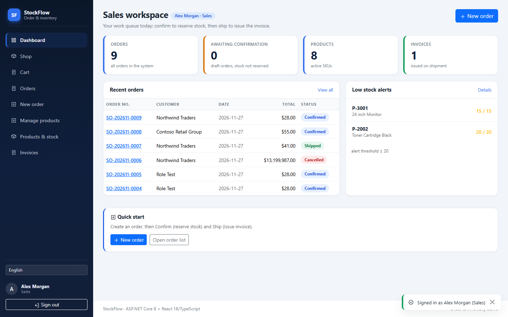
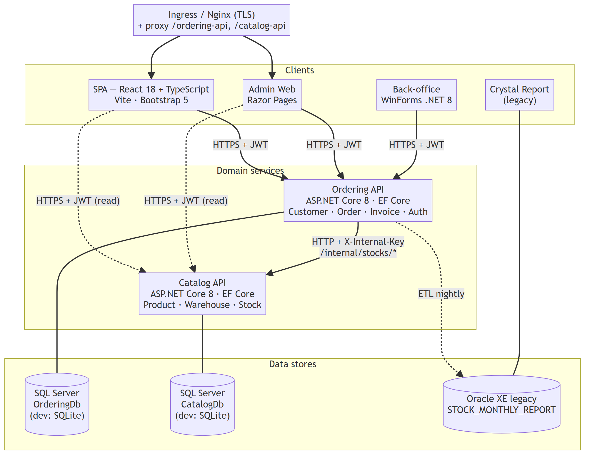
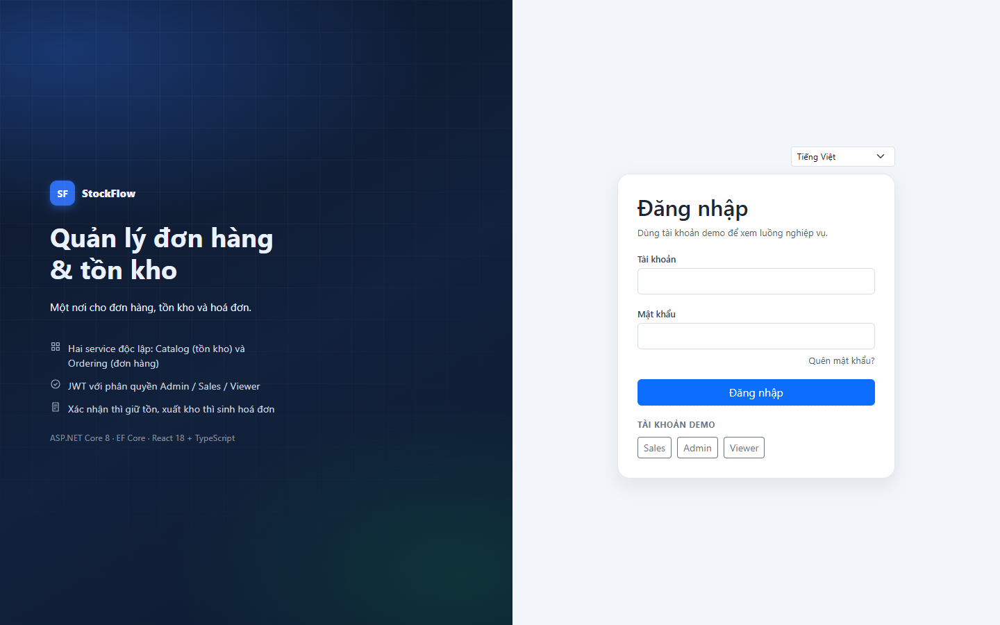
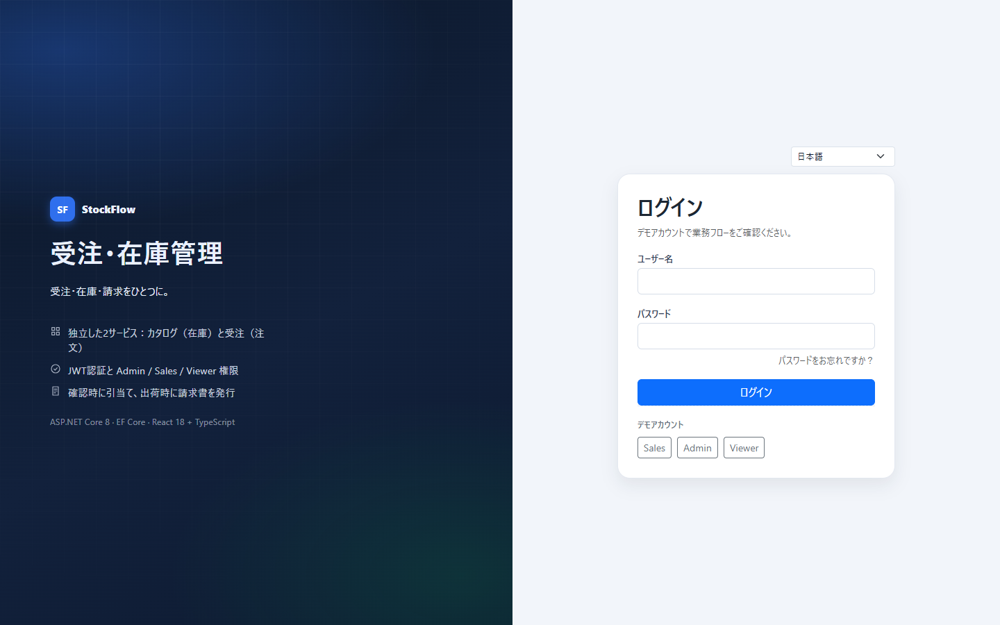
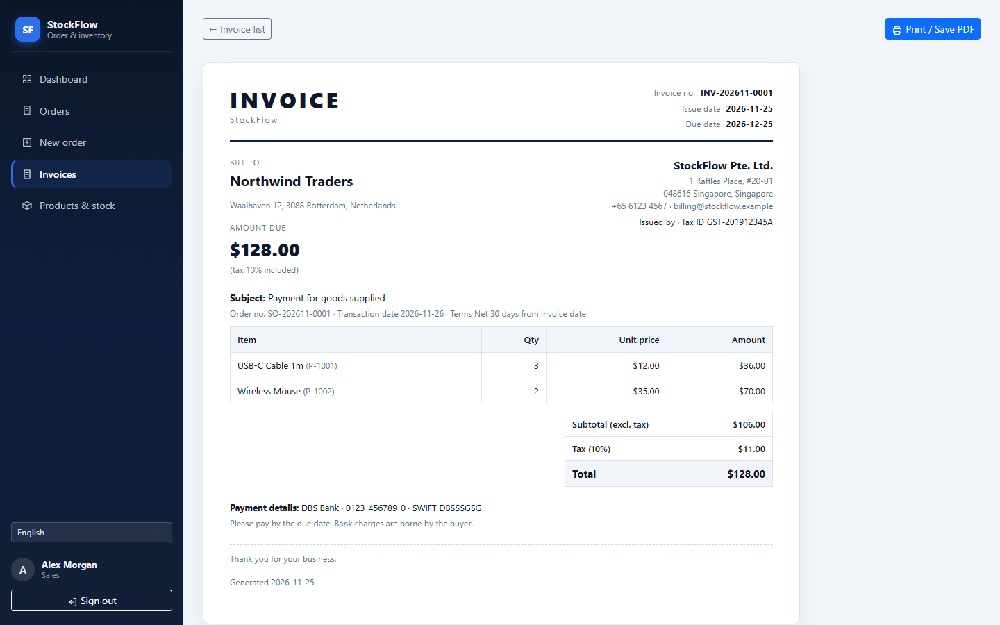

# StockFlow — Order & Inventory Management

A full-stack reference implementation of an order + inventory system, built the way an outsourcing
team would deliver it: two .NET services, a typed React SPA, printable invoices, and a real test suite.

**Ships multilingual (English · Tiếng Việt · 日本語)** with an in-app language switcher — sample data,
branding and currency are generic, so the project is not tied to any single client or market.

| Verified | Result |
|---|---|
| Release build | 0 warnings / 0 errors (9 .NET projects) |
| Domain unit tests | 32/32 pass |
| API end-to-end (`scripts/smoke-api.ps1`) | 8/8 steps (including the 409 out-of-stock path) |
| UI end-to-end (Playwright + Chrome) | pass, 0 console/network errors |
| Browser QA suite (`scripts/qa/run-all.ps1`) | scenarios for auth, orders, RBAC, forms, navigation, invoices, i18n |



---

## 1. Architecture



| Component | Tech | Responsibility |
|---|---|---|
| `Catalog.Api` | ASP.NET Core 8, EF Core 8 | Product, Warehouse, Stock, StockMovement |
| `Ordering.Api` | ASP.NET Core 8, EF Core 8, JWT | Customer, Order (aggregate), Invoice, Auth, Company profile |
| `Web.Spa` | React 18 + TypeScript + Vite + Bootstrap 5 | **Main app**: dashboard, orders, order detail, invoice printing, stock, i18n |
| `Web` | Razor Pages | Server-side admin (comparison point for the two FE approaches) |
| `Desktop` | WinForms (net8.0-windows) | Back-office: confirm / ship / cancel |
| `Shared/Contracts` | classlib | DTOs shared by all clients and services |
| `Shared/BuildingBlocks` | classlib | DomainException, JWT, PBKDF2 hashing, internal-key filter |
| `Shared/Persistence` | classlib | EF provider switch (SqlServer/Sqlite), rowversion helper, CORS |

Details: [ERD + data dictionary](docs/ERD.md) · [Architecture & flows](docs/ARCHITECTURE.md) ·
[Competitor research & roadmap](docs/RESEARCH.md)

---

## 2. Core business rules

```
Draft ──confirm (reserve stock)──> Confirmed ──ship (issue stock + invoice)──> Shipped
  │                                   │
  └─────────────cancel───────────────┴──> Cancelled (release reservation)
```

Enforced in the domain (`Order`, `Stock`) and covered by unit tests:

- `SubTotal = Σ LineAmount`, `TaxAmount = round(SubTotal × 10%)`, `TotalAmount = SubTotal + TaxAmount`
- Cannot confirm an empty order, cannot edit a confirmed order, cannot cancel a shipped order
- `Available = QuantityOnHand − QuantityReserved` — confirm reserves, ship deducts
- Out of stock → `409` with per-SKU detail, the order **stays Draft** (no half-commit)
- Price and product name are **snapshotted** into `ORDER_LINE` so history survives master-data changes

---

## 3. Run it

### Option 1 — Docker Compose (SQL Server)

```bash
docker compose -f deploy/docker-compose.yml up --build
```

| Service | URL |
|---|---|
| **SPA** | http://localhost:5082 |
| Razor admin | http://localhost:5084 |
| Catalog API (Swagger) | http://localhost:5080/swagger |
| Ordering API (Swagger) | http://localhost:5081/swagger |

### Option 2 — Local, no database server needed (recommended for dev)

The APIs use **SQLite** in `Development` (`appsettings.Development.json`); the database file is
created and seeded on first run.

```bash
# terminal 1 — Catalog API  :5080
dotnet run --project src/Services/Catalog/StockFlow.Inventory.Catalog.Api

# terminal 2 — Ordering API :5081
dotnet run --project src/Services/Ordering/StockFlow.Inventory.Ordering.Api

# terminal 3 — SPA dev server :5173 (proxies /ordering-api and /catalog-api)
cd src/Web.Spa && npm install && npm run dev
```

Open http://localhost:5173.

> ⚠️ If the repo path contains `#` (e.g. `E:\C# Project`), Vite cannot run `dev`/`build` there.
> Use `scripts/build-spa.ps1` for a production build, or move the checkout to a path without `#`.

### Option 3 — Production build of the SPA

```bash
powershell -ExecutionPolicy Bypass -File scripts/build-spa.ps1   # handles the '#' path
cd src/Web.Spa && npm run preview                                # http://localhost:4173
```

### Desktop (WinForms)

```bash
dotnet run --project src/Desktop/StockFlow.Inventory.Desktop
```

### Demo accounts (seeded)

| Account | Password | Role |
|---|---|---|
| `admin` | `Admin@123` | Admin — manage products, adjust stock, all order actions |
| `sales` | `Sales@123` | Sales — create / confirm / ship / cancel orders |
| `viewer` | `Viewer@123` | Read-only (business actions hidden) |

---

## 4. Multilingual UI (EN / VI / JA)

- Language switcher in the sidebar and on the sign-in screen; choice persists in `localStorage`
  and drives `<html lang>`.
- All strings live in one file: `src/Web.Spa/src/i18n/messages.ts` — one row per key, three
  translations (`[vi, en, ja]`), so adding a language is a single column.
- Numbers, currency (USD) and dates are formatted with `Intl` for the active locale.
- QA tests target `data-testid` attributes, so they do not break when the language changes.

| English | Tiếng Việt | 日本語 |
|---|---|---|
|  |  |  |

---

## 5. Invoices

Invoices are generated automatically when an order is shipped and can be printed to A4 or saved as PDF.



- `GET /api/invoices` (list), `GET /api/invoices/{id}` (full document), `GET /api/company` (seller profile).
- Seller details (`Company:*` in configuration) are never hard-coded — name, address, tax ID, bank,
  payment terms and currency all come from configuration.
- `@media print` hides the app shell and `@page { size: A4 }` produces a clean single-page document.

---

## 6. API surface

| Method | Endpoint | Notes |
|---|---|---|
| POST | `/api/auth/login` | Issues a JWT (Ordering service) |
| GET | `/api/products`, `/api/stocks`, `/api/warehouses` | Catalog reads |
| POST | `/api/products`, `/api/stocks/adjust` | Catalog writes, role `Admin` |
| GET | `/api/customers` | Ordering |
| GET | `/api/orders`, `/api/orders/{id}` | Paged list / single order |
| POST | `/api/orders` | Create draft (prices fetched from Catalog) |
| POST | `/api/orders/{id}/confirm` | Reserve stock → Confirmed |
| POST | `/api/orders/{id}/ship` | Issue stock → Shipped + invoice |
| POST | `/api/orders/{id}/cancel` | Cancel + release reservation |
| GET | `/api/invoices`, `/api/invoices/{id}` | Invoice list + printable document |
| GET | `/api/company` | Seller profile for invoices |
| POST | `/internal/stocks/reserve\|release\|issue` | Service-to-service (`X-Internal-Key`) |

---

## 7. Testing

```bash
# 1) Domain unit tests (no database)
dotnet test tests/StockFlow.Inventory.Tests/StockFlow.Inventory.Tests.csproj

# 2) API end-to-end (needs both services on :5080/:5081)
powershell -ExecutionPolicy Bypass -File scripts/smoke-api.ps1

# 3) UI end-to-end (needs APIs + SPA preview on :4173)
cd src/Web.Spa && npm run e2e

# 4) Interactive browser QA suite (needs the browser driver)
node tools/browser-driver/driver.mjs                              # terminal A
powershell -ExecutionPolicy Bypass -File scripts/qa/run-all.ps1    # terminal B
```

`tools/browser-driver` keeps a live Chrome session and accepts commands over HTTP, so a test can
open pages, click, read text, switch language and take screenshots step by step:

```powershell
. .\scripts\bc-lib.ps1
Bc-Open 'http://localhost:4173/'
Bc-Fill '[data-testid=login-username]' 'sales'
Bc-Fill '[data-testid=login-password]' 'Sales@123'
Bc-Click '[data-testid=login-submit]'
Bc-Select '[data-testid=lang-switcher]' 'ja'
Bc-Shot 'check-ja'
```

---

## 8. Engineering notes

- **SQLite for dev**: `Database:Provider=Sqlite` runs with zero setup. `rowversion` optimistic
  concurrency is only enforced on SQL Server (`Shared/Persistence/RowVersionExtensions.cs`).
- **Path with `#`**: Vite/Rollup cannot handle it → `scripts/build-spa.ps1` builds in a temp
  directory and copies `dist` back.
- **Migrations**: dev/demo uses `EnsureCreated()`; production sets `Database:AutoCreate=false` and
  uses EF migrations.
- **Secrets**: never committed — use env vars (`ConnectionStrings__*`, `Jwt__Key`, `Internal__ApiKey`).

### Design decisions worth defending

| Decision | Why | Accepted trade-off |
|---|---|---|
| Two services by bounded context | Catalog changes rarely, Ordering changes often → independent deploys | No cross-service FKs; validate + snapshot instead |
| Reserve-first + compensation | Two steps only; reserve is idempotent per order number | Stock is briefly held if the second step fails (release + log covers it) |
| Optimistic concurrency (`rowversion`) | Two sellers confirming the last unit → one wins, the other gets 409 | Client must retry |
| Append-only `STOCK_MOVEMENT` | Auditable, reconciles with external reports | Table grows → archive later |
| Price/name snapshot in `ORDER_LINE` | Historical orders never change when master data does | Intentional duplication |
| SPA + Razor side by side | SPA for the product UI, Razor for fast internal admin | Two frontends to maintain |

Things deliberately **not** built are listed at the end of [ARCHITECTURE.md](docs/ARCHITECTURE.md).
