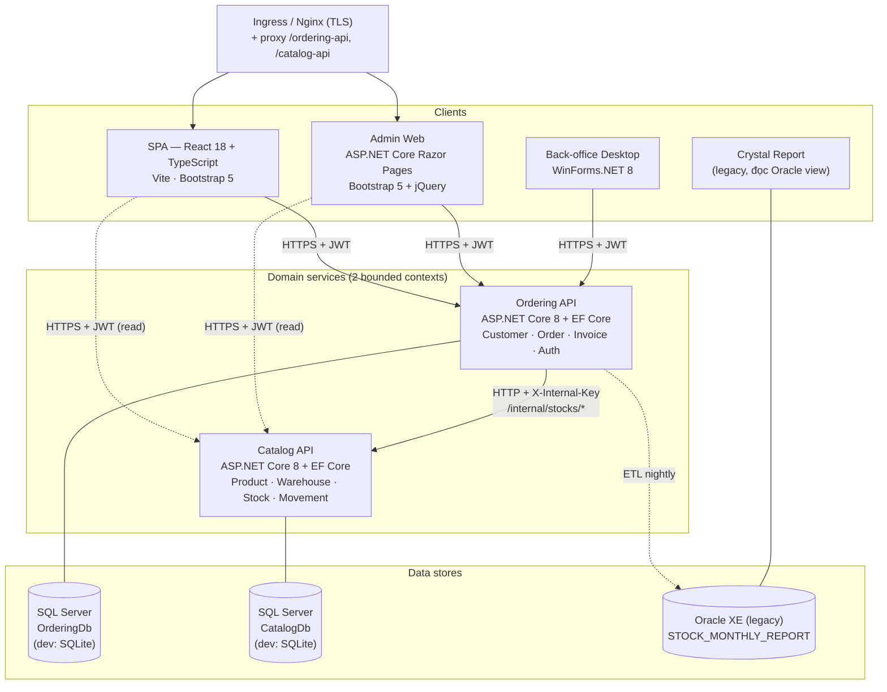
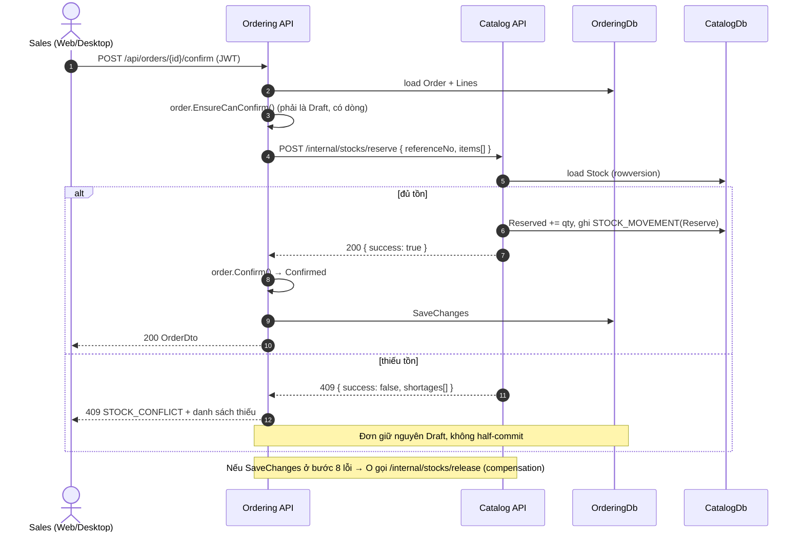
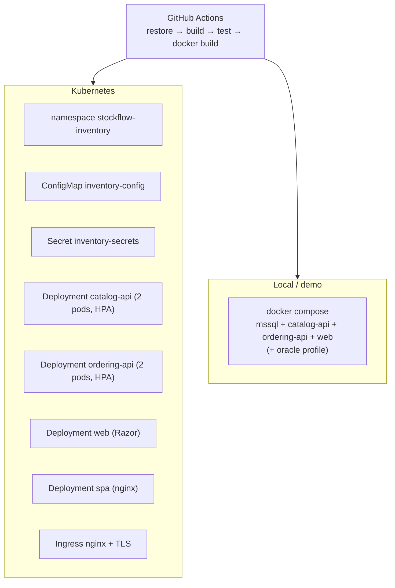

# Kiến trúc hệ thống — 

Tài liệu này mô tả **cấu trúc hệ thống** (system structure) đi kèm [ERD](./ERD.md). Mục tiêu: một ứng viên đọc xong có thể vẽ lại trên bảng trắng trong 5 phút, và bảo vệ được từng quyết định kiến trúc.

---

## 1. Sơ đồ tổng thể (container level)



**Vì sao 2 service, không phải 5–7?** Ranh giới cắt theo *bounded context* + *nhịp thay đổi*, không cắt theo bảng: Catalog (master data + tồn kho) đổi rất ít, Ordering (nghiệp vụ đơn/hóa đơn) đổi liên tục. Đây là mức chia nhỏ trung thực cho một hệ thống nội bộ vài chục user — tách thêm chỉ đổi lấy network hop và eventual consistency mà không có lợi ích.

---

## 2. Cấu trúc solution (physical structure)

```
StockFlowInventory.sln
├─ src/
│ ├─ Shared/
│ │ ├─ StockFlow.Inventory.Contracts/      # DTO dùng chung (POCO, không dependency)
│ │ │ ├─ Catalog/ (Product, Stock, Reserve...)
│ │ │ ├─ Ordering/ (Order, Invoice, ShipResult)
│ │ │ └─ Security/ (JwtOptions, LoginRequest/Response, Roles)
│ │ └─ StockFlow.Inventory.BuildingBlocks/    # Shared kernel: DomainException, JWT, PBKDF2, filter
│ │   ├─ DomainException.cs
│ │   ├─ Http/DomainExceptionHandler.cs    # map exception → JSON lỗi thống nhất
│ │   └─ Security/ (AuthExtensions, InternalApiKeyFilter, PasswordHasher)
│ │ └─ StockFlow.Inventory.Persistence/     # EF provider (SqlServer/Sqlite), rowversion helper, CORS
│ ├─ Services/
│ │ ├─ Catalog/StockFlow.Inventory.Catalog.Api/
│ │ │ ├─ Domain/  (Product, Warehouse, Stock, StockMovement, DomainExceptions)
│ │ │ ├─ Data/   (CatalogDbContext, CatalogSeeder)
│ │ │ ├─ Services/ (StockService, Mapping)
│ │ │ └─ Endpoints/ (ProductEndpoints, StockEndpoints, InternalEndpoints)
│ │ └─ Ordering/StockFlow.Inventory.Ordering.Api/
│ │   ├─ Domain/  (Order aggregate, OrderLine, Customer, Invoice, AppUser)
│ │   ├─ Data/   (OrderingDbContext, OrderingSeeder)
│ │   ├─ Services/ (OrderService, CatalogClient, JwtTokenService, Mapping)
│ │   └─ Endpoints/ (AuthEndpoints, CustomerEndpoints, OrderEndpoints, InvoiceEndpoints)
│ ├─ Web.Spa/                  # React 18 + TypeScript + Vite (FE chính)
│ │ ├─ src/api/    (client.ts, ordering.ts, catalog.ts, types.ts)
│ │ ├─ src/auth/   (AuthContext, RequireAuth)
│ │ ├─ src/components/(AppLayout, Modal, Toast, StatusBadge, Icon, Feedback)
│ │ ├─ src/pages/   (Login, Dashboard, Orders, OrderCreate, Products)
│ │ ├─ e2e/smoke.mjs (Playwright: login → tạo đơn → confirm → ship)
│ │ └─ nginx.conf, Dockerfile
│ ├─ Web/StockFlow.Inventory.Web/         # Razor Pages + Bootstrap/jQuery, gọi API
│ └─ Desktop/StockFlow.Inventory.Desktop/     # WinForms back-office, gọi API
├─ tests/StockFlow.Inventory.Tests/        # xUnit: domain rules (order state machine, stock ledger)
├─ tools/StockFlow.Inventory.ModelCheck/      # sinh DDL từ EF model (không cần DB)
├─ scripts/ (build-spa.ps1, smoke-api.ps1)
├─ database/ (oracle/plsql/, sqlserver/)
├─ deploy/  (docker-compose.yml, k8s/)
├─ docs/   (ERD.md, ARCHITECTURE.md, diagrams/, img/)
└─.github/workflows/ci.yml
```

### Quy ước phân lớp trong mỗi service

| Lớp | Trách nhiệm | Không được làm |
|---|---|---|
| `Domain/` | Bất biến nghiệp vụ, state machine, throw `DomainException` | Không biết EF/HTTP/DI |
| `Data/` | Mapping EF Core, index, check constraint, seed | Không chứa luật nghiệp vụ |
| `Services/` | Điều phối nhiều aggregate / nhiều service, transaction | Không parse HTTP request |
| `Endpoints/` | Route, validate input, map DTO, status code | Không chứa luật nghiệp vụ |

Lợi ích thực tế: toàn bộ luật đơn hàng/tồn kho test được **không cần database** (xem `tests/`), nên CI chạy vài giây.

### Cấu trúc frontend (SPA)

| Lớp | File | Trách nhiệm |
|---|---|---|
| `api/` | `client.ts` | `fetch` wrapper: 2 base URL, Bearer token, chuẩn hoá lỗi thành `ApiError`, phát event `401` để auto-logout |
| `api/` | `ordering.ts`, `catalog.ts`, `types.ts` | Hàm gọi API typed; `types.ts` mirror DTO của `Contracts` |
| `auth/` | `AuthContext.tsx`, `RequireAuth.tsx` | Trạng thái đăng nhập (sessionStorage), phân quyền UI, bảo vệ route |
| `components/` | `AppLayout`, `Modal`, `Toast`, `StatusBadge`, `Icon`, `Feedback` | UI tái sử dụng; `Icon` là SVG inline (không phụ thuộc icon-font) |
| `pages/` | `LoginPage`, `DashboardPage`, `OrdersPage`, `OrderCreatePage`, `ProductsPage` | Màn hình nghiệp vụ |
| `lib/` | `format.ts`, `useAsync.ts` | Format tiền/ngày/thuế (cùng công thức với BE) + hook load dữ liệu |

Nguyên tắc: **client không phải nguồn sự thật** — tổng tiền hiển thị do client tính để phản hồi tức thì, nhưng khi lưu thì backend tính lại và trả về con số cuối cùng.

---

## 3. Luồng nghiệp vụ quan trọng nhất: Confirm đơn hàng



Ba điểm đáng nói khi phỏng vấn:

1. **Không dùng distributed transaction** (2PC/Saga nặng): chọn *reserve-first + compensation* vì reserve là thao tác idempotent theo `referenceNo`.
2. **Idempotency**: Catalog bỏ qua nếu đã có `STOCK_MOVEMENT(Reserve)` cùng `referenceNo` → client retry an toàn.
3. **Optimistic concurrency**: `rowversion` trên `STOCK` + retry 3 lần; thua race thì trả `409` kèm số tồn thật để sale báo khách.

Luồng `Ship`: `Issue` tồn thực tế ở Catalog → `Order.MarkShipped()` → sinh `INVOICE` trong **cùng một** `SaveChanges` của Ordering.

---

## 4. Triển khai (deployment structure)



| Môi trường | DB | Cấu hình |
|---|---|---|
| Local dev (`dotnet run`) | **SQLite** (`appsettings.Development.json`) | `Database:AutoCreate=true`, seed tự động, không cần cài SQL Server |
| Demo (`docker compose`) | container `mssql` | secret qua biến môi trường |
| Production (K8s) | Azure SQL / SQL Server managed | `AutoCreate=false` → dùng EF migrations, secret qua Key Vault/Sealed Secrets |

Cổng quy ước: Catalog `5080`, Ordering `5081`, **SPA `5082`**, admin Razor `5084` (trong container luôn `8080`;
SPA dev server dùng `5173`, preview `4173`).

---

## 5. Bảo mật

| Hạng mục | Cách làm | Ghi chú |
|---|---|---|
| Xác thực người dùng | JWT HS256 do Ordering phát hành (`/api/auth/login`), hạn 8h | Razor Web giữ token trong **Session server-side**; SPA giữ trong `sessionStorage` (demo) — production nên đổi sang httpOnly cookie + refresh token |
| Mật khẩu | PBKDF2-SHA256, 100k vòng, salt 16B, so sánh `FixedTimeEquals` | Không dùng Identity để giữ dependency tối thiểu |
| Phân quyền | `Admin` / `Sales` / `Viewer` qua `RequireAuthorization(Roles=…)` | Viewer chỉ đọc |
| Service-to-service | Header `X-Internal-Key` (so sánh hằng thời gian) + `/internal/*` không expose qua Ingress | Production: thay bằng mTLS hoặc workload identity |
| Secrets | env var / Secret K8s, không commit | `appsettings.json` chỉ chứa giá trị dev |

---

## 6. Quan sát & vận hành (mức demo)

- `GET /health` ở cả hai API: kiểm tra luôn kết nối DB → dùng cho readiness/liveness probe.
- Log có cấu trúc (ILogger), mọi lỗi domain log mức `Warning` kèm mã lỗi.
- Log ghi ra **stdout** (`Logging.ClearProviders()` + `AddSimpleConsole`) theo 12-factor: container/CI không có quyền ghi Windows Event Log, và log tập trung do platform thu.
- Lỗi trả về thống nhất `{ code, message }` (ApiError) → SPA/Razor/Desktop hiển thị trực tiếp.
- Có Dockerfile multi-stage (API runtime ~220MB, SPA = nginx alpine phục vụ static + proxy), chạy `USER $APP_UID` (non-root), HPA + probe trong K8s.

---

## 7. Đối chiếu yêu cầu JD → thành phần trong repo

| Yêu cầu JD | Nơi thể hiện |
|---|---|
| C#,.NET 8, ASP.NET Core, EF Core | toàn bộ `src/` (target `net8.0`, EF Core 8.0.11) |
| REST API | `Endpoints/*.cs` (minimal API) + Swagger UI |
| Microservices | 2 service tách DB, giao tiếp qua `/internal/*` |
| Docker / K8s | `Dockerfile` × 4 (2 API + SPA + Razor), `deploy/docker-compose.yml`, `deploy/k8s/` |
| **React 18 + TypeScript** | **`src/Web.Spa`** (Vite, React Router, typed API client, Playwright E2E) |
| HTML, CSS, JS, jQuery, Bootstrap | `src/Web` (Razor Pages, `wwwroot/js/orders-create.js` dùng jQuery, Bootstrap 5) |
| WinForms | `src/Desktop` (DataGridView + async HTTP) |
| SQL Server | EF Core SqlServer, index/check constraint/rowversion |
| **SQLite (dev)** | `Database:Provider=Sqlite` — chạy được ngay, không cần cài DB server |
| Oracle + PL/SQL | `database/oracle/plsql/sp_build_monthly_stock_report.sql` |
| Crystal Report | Luồng báo cáo tồn kho tháng + view `V_STOCK_MONTHLY` cho Crystal |
| Git | Lịch sử commit theo Conventional Commits, `.gitignore`, CI |
| Kiểm thử | `tests/` (xUnit 32 case) + `scripts/smoke-api.ps1` (API E2E) + `src/Web.Spa/e2e` (UI E2E) |
| Đọc tài liệu tiếng Anh | README + docs song ngữ Việt/Anh/Nhật |
| Tiếng Nhật (lợi thế) | Thuật ngữ // trong code, UI, tài liệu |
| AI hỗ trợ lập trình | Xem mục "AI-assisted workflow" trong README |

---

## 8. Những gì cố tình KHÔNG làm (và lý do)

| Bỏ qua | Lý do | Nếu cần thì làm gì |
|---|---|---|
| Message broker (RabbitMQ/Kafka) | Reserve đồng bộ cần kết quả ngay; event chỉ dùng cho báo cáo | Outbox pattern + Kafka cho `OrderShipped` |
| Saga orchestrator | Chỉ 2 bước, compensation thủ công là đủ và dễ hiểu | MassTransit saga khi có ≥3 service |
| CQRS / read model | Dữ liệu nhỏ, báo cáo chạy ban đêm ở Oracle | Materialized view / projection |
| Multi-tenant | Chưa có yêu cầu | Thêm `TenantId` + global query filter |
| Dapper cho query phức tạp | Chưa có query nào chậm | Dapper cho report nặng |
