# Demo luồng người dùng — StockFlow Marketplace

Kịch bản demo 16 bước, chạy tự động, chụp ảnh từng bước. Dùng để trình bày với khách/team.

- **Thời lượng**: ~3 phút
- **URL**: http://localhost:4173
- **Ảnh chụp**: `docs/demo/` (16 ảnh + 1 PDF hoá đơn)

---

## Chuẩn bị (1 lần)

Cần 3 service + browser driver đang chạy:

```powershell
dotnet run --project src/Services/Catalog/StockFlow.Inventory.Catalog.Api      # :5080
dotnet run --project src/Services/Ordering/StockFlow.Inventory.Ordering.Api    # :5081
cd src/Web.Spa; npm run preview                                                # :4173
node tools/browser-driver/driver.mjs                                           # :4599
```

Reset dữ liệu sạch (8 sản phẩm, 4 tài khoản, 0 đơn):

```powershell
Get-ChildItem -Recurse -Include 'stockflow-*.db' | Remove-Item -Force
# rồi khởi động lại 2 API
```

Chạy lại toàn bộ demo (tự chụp ảnh + kiểm tra từng bước):

```powershell
powershell -NoProfile -ExecutionPolicy Bypass -File scripts/demo-user-flow.ps1
```

---

## Tài khoản

| Vai trò | Tài khoản | Mật khẩu | Thấy gì |
|---|---|---|---|
| Khách mua hàng | tự đăng ký ở `/register` | — | Cửa hàng, giỏ, đơn của tôi |
| Sales | `sales` | `Sales@123` | + Quản lý sản phẩm, đơn hàng, hoá đơn |
| Admin | `admin` | `Admin@123` | + Tài khoản, Trạng thái |
| Viewer | `viewer` | `Viewer@123` | Chỉ đọc, không có menu quản trị |

Thẻ test: `4242 4242 4242 4242` · `12/29` · `123` (sandbox, không giao dịch thật)

---

## Luồng demo

### Phần 1 — Khách mua hàng (không cần đăng nhập để xem)

| # | Bước | Nói gì khi demo | Ảnh |
|---|---|---|---|
| 01 | Mở `/shop` | "Khách vãng lai xem được hàng ngay, không phải đăng nhập. Giá và tồn kho lấy trực tiếp từ Catalog API." | 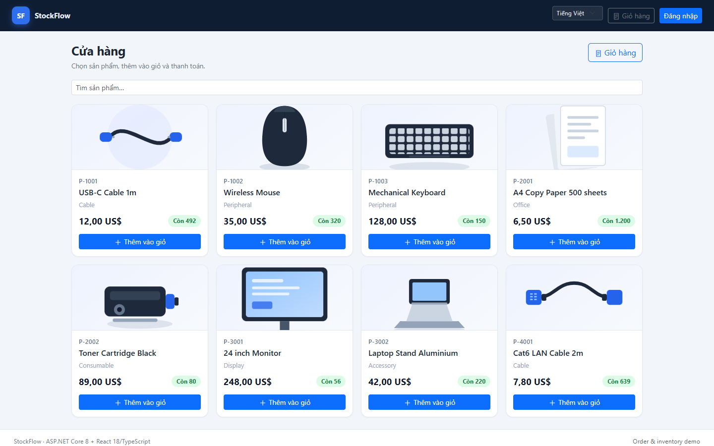 |
| 02 | Gõ "monitor" vào ô tìm kiếm | "Lọc theo mã hoặc tên, chạy ngay trên client." | 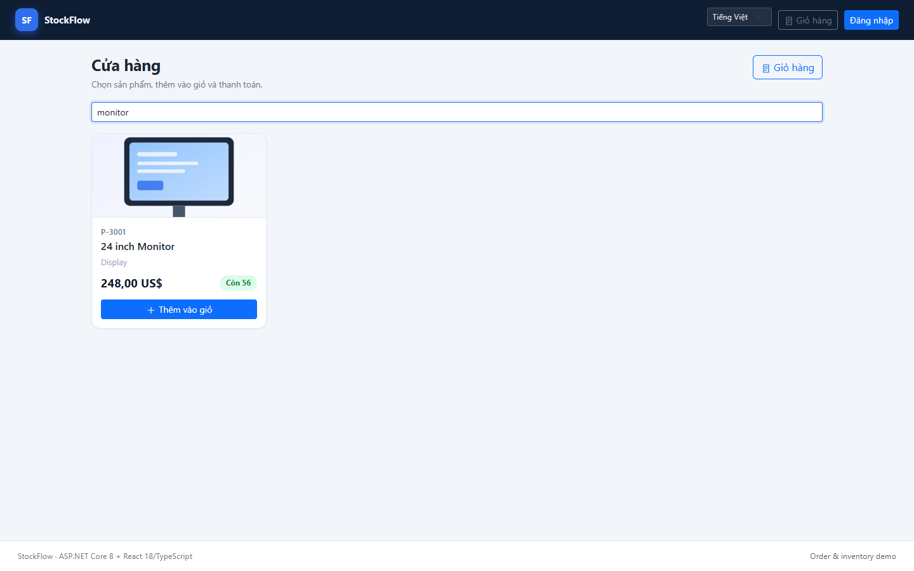 |
| 03 | Mở chi tiết, chọn SL = 2 | "Trang chi tiết cho biết kho xuất hàng và số lượng còn." | 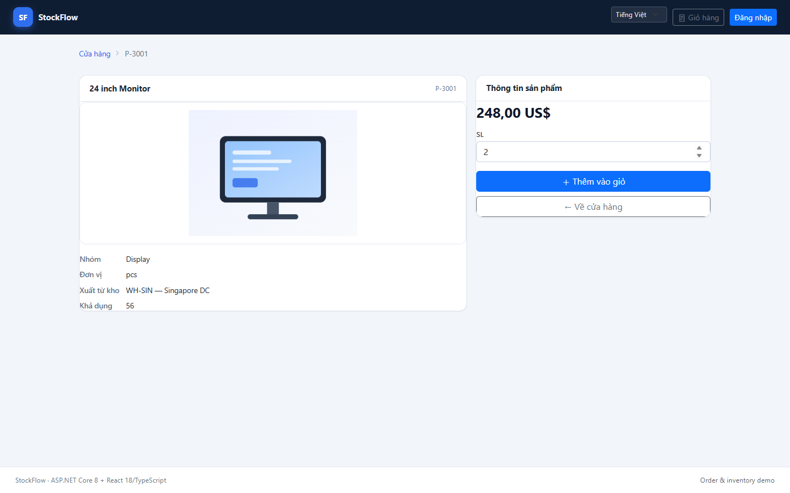 |
| 04 | Thêm sản phẩm thứ hai | "Giỏ hàng giữ ở trình duyệt, thêm nhiều món." | 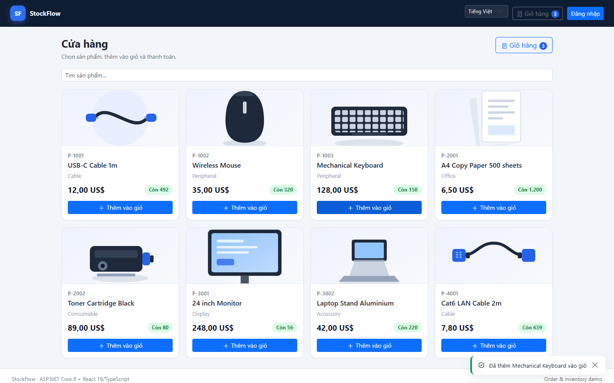 |
| 05 | Đăng ký tài khoản | "Chỉ cần tên đăng nhập + mật khẩu; hệ thống tự tạo hồ sơ khách hàng và đăng nhập luôn." | 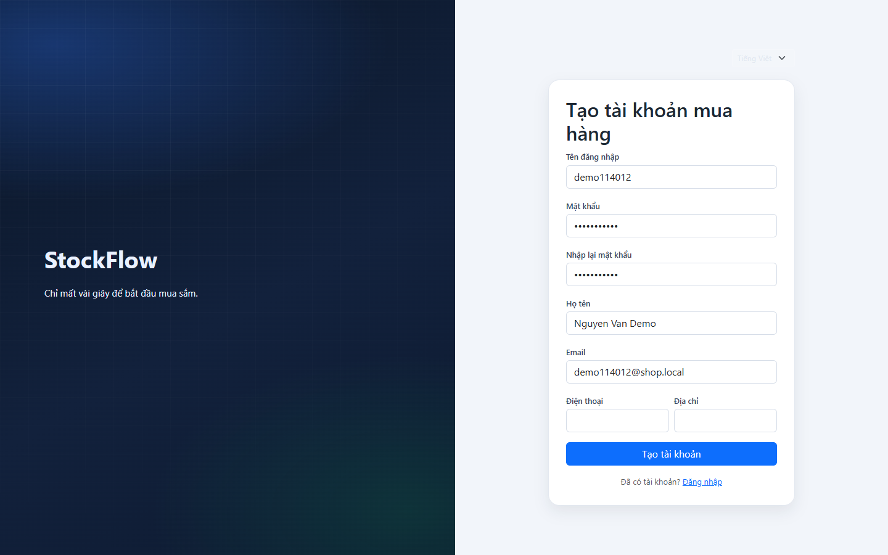 |
| 06 | Vào giỏ, đổi SL | "Tổng tiền + thuế 10% tính lại ngay: 686 → 827 US$." | 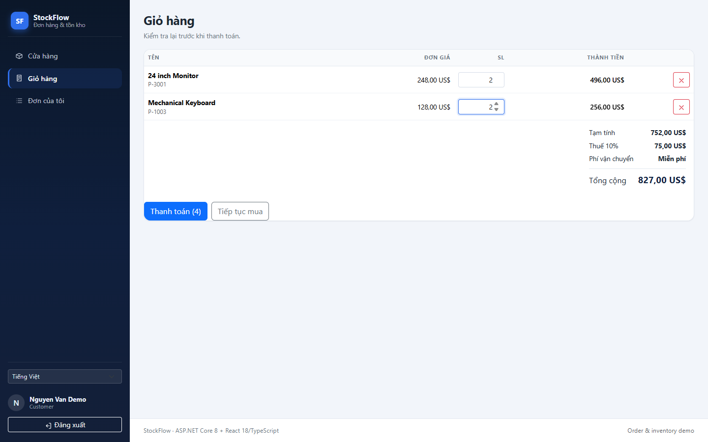 |
| 07 | Nhập địa chỉ + thẻ → Thanh toán | "Một lần bấm: tạo đơn → **giữ tồn** → thu tiền. Giữ tồn trước khi thu tiền nên không bán quá số lượng." | 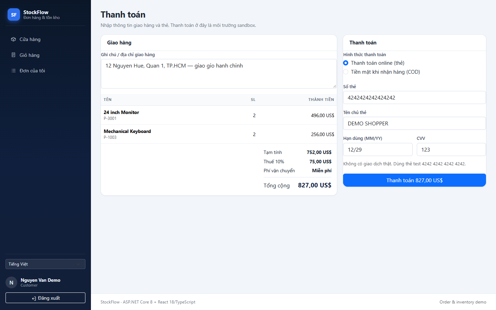 |
| 08 | Trang Đơn của tôi | "Đơn SO-202611-0001 · Confirmed · **Đã thanh toán**, có mã giao dịch." | 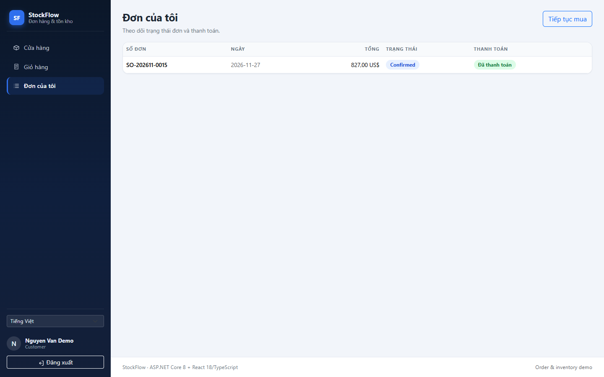 |

### Phần 2 — Back office xử lý đơn

| # | Bước | Nói gì khi demo | Ảnh |
|---|---|---|---|
| 09 | Admin đăng nhập → Đơn hàng | "Đơn của khách hiện ngay bên admin, trạng thái đã thanh toán." | 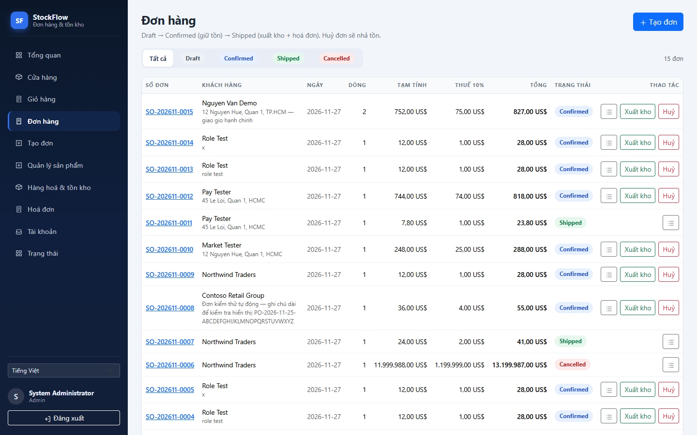 |
| 10 | Bấm Xuất kho | "Xuất kho = trừ tồn thật + sinh hoá đơn, trong cùng một transaction." | 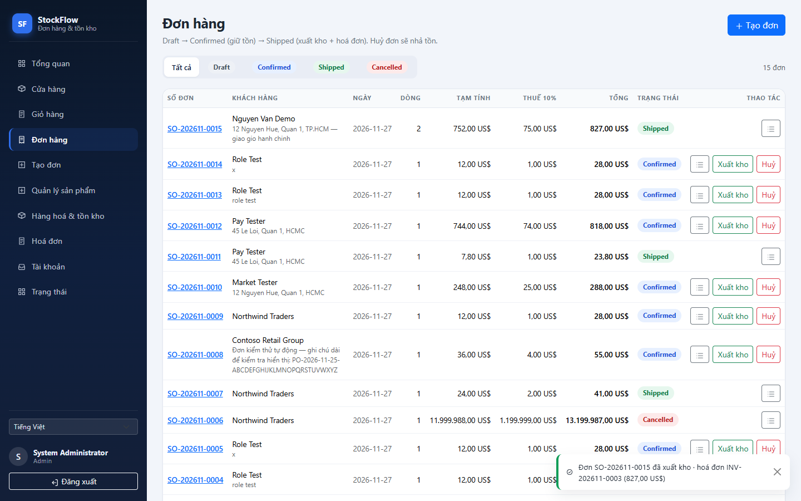 |
| 11 | Hoá đơn | "Hoá đơn sinh tự động, mỗi đơn đúng 1 hoá đơn." | 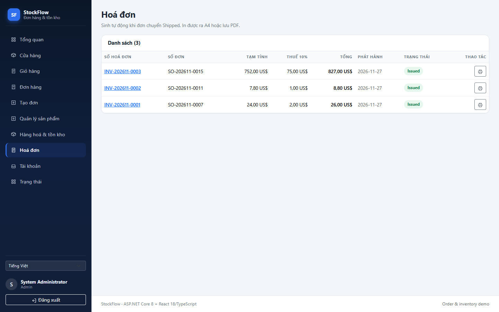 |
| 12 | In / Lưu PDF | "Bản in có mã số thuế, điều khoản Net 30, thông tin chuyển khoản. Tổng 827 US$ khớp đơn." | 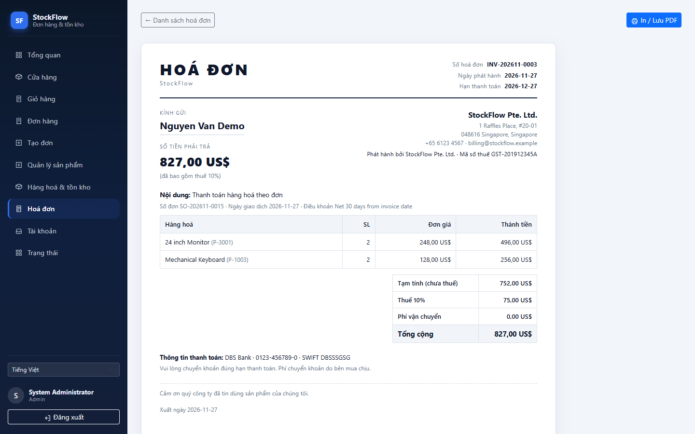 |
| 13 | Trạng thái | "Admin thấy doanh thu đã thu và số đơn theo trạng thái." | 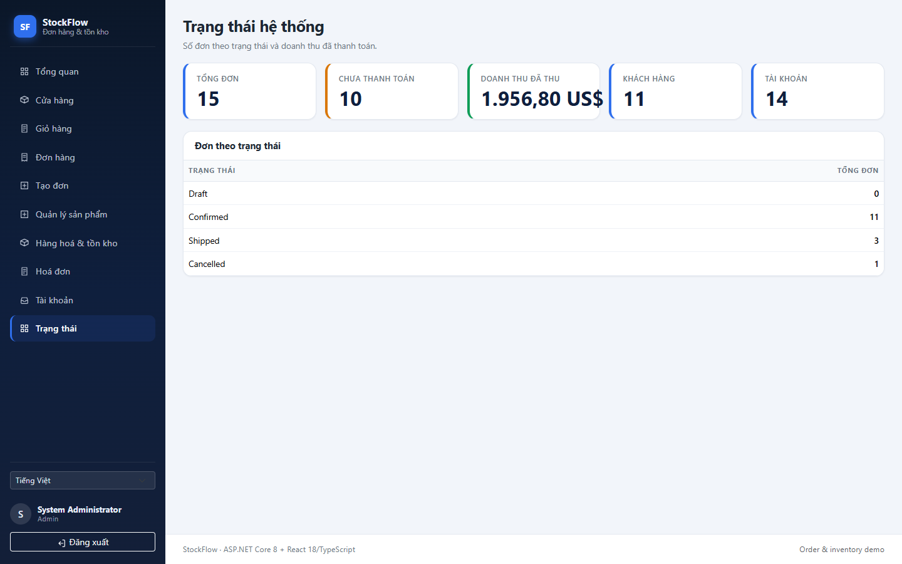 |

### Phần 3 — Phân quyền

| # | Bước | Nói gì khi demo | Ảnh |
|---|---|---|---|
| 14 | Sales → Quản lý sản phẩm | "Sales tự sửa giá, sửa ảnh, điều chỉnh tồn kho — không cần admin." | 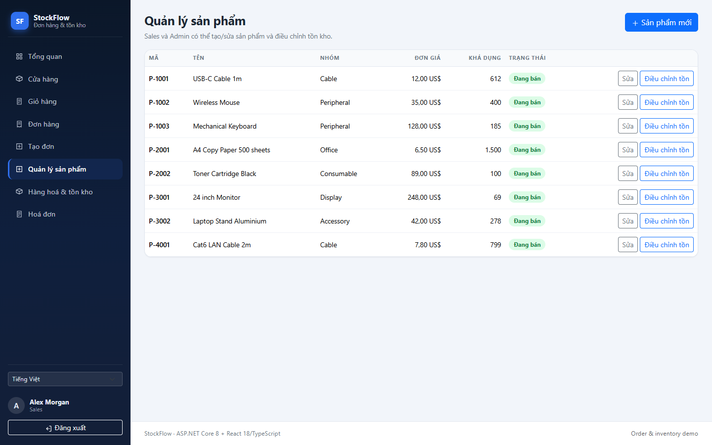 |
| 15 | Viewer đăng nhập | "Viewer chỉ đọc: menu không có Tài khoản/Quản lý sản phẩm, gõ URL cũng bị chặn." | 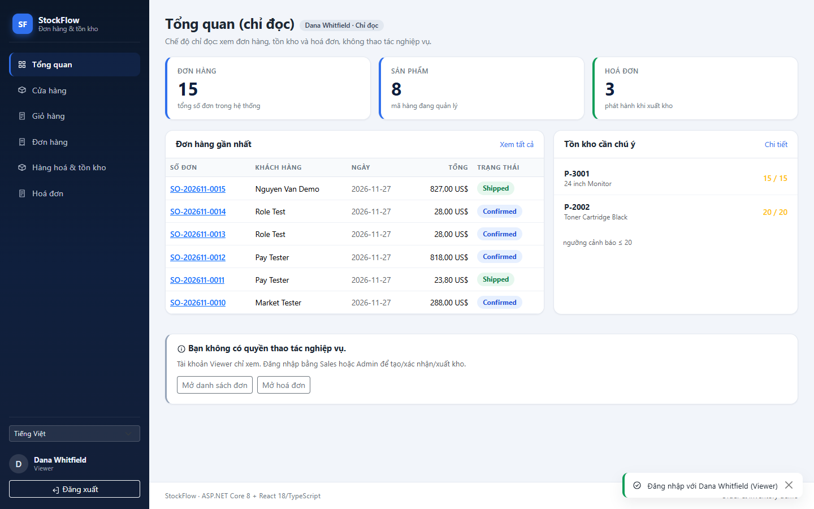 |
| 16 | Console | "Không có lỗi JS trong suốt luồng." | — |

---

## Điểm nhấn để nói (nếu bị hỏi)

| Câu hỏi | Trả lời |
|---|---|
| Bán quá tồn được không? | Không. Checkout gọi reserve ở Catalog API; hết hàng trả 409, đơn thứ hai bị từ chối. |
| Chưa thanh toán mà xuất kho được không? | Không. `MarkShipped` chặn nếu payment ≠ Paid. |
| Thanh toán thật chưa? | Chưa — sandbox: validate thẻ (Luhn, hạn, CVV), chỉ lưu mã tham chiếu, không lưu số thẻ. Thay cổng thật chỉ sửa 1 chỗ trong `ShopService`. |
| Huỷ đơn thì tồn thế nào? | Release reservation về kho, ghi `STOCK_MOVEMENT`, tồn khả dụng tăng lại. |
| Đổi ngôn ngữ? | Nút góc dưới trái: Tiếng Việt / English / 日本語. |
| Mobile? | Responsive; các cột phụ ẩn dưới 720px. |

---

## Ghi chú kỹ thuật

- Ảnh sản phẩm: SVG vector trong `src/Web.Spa/public/products/` — sửa ảnh bằng cách thay file hoặc đổi `Image URL` ở trang **Quản lý sản phẩm**.
- Tiền tệ: USD, thuế 10%, làm tròn `AwayFromZero` (khớp với backend).
- DB dev: SQLite (`stockflow-catalog.db`, `stockflow-ordering.db`) — xoá là seed lại.

## Bug tìm ra trong lúc làm demo này

Hoá đơn in ra **902 US$** trong khi đơn là **827 US$**: `InvoiceDetailDto.Amount` map bằng `order.TotalAmount` (đã gồm thuế) nên trang in cộng thuế lần nữa. Đã sửa map về `invoice.Amount` (trước thuế) → 752 + 75 = 827, khớp đơn. Verify lại bằng API: `subTotal=752, tax=75, total=827 = order.totalAmount`.

---

## Cập nhật: 2 phương thức thanh toán + phí vận chuyển

### Thanh toán

| Phương thức | Luồng | Đơn sau khi đặt |
|---|---|---|
| **Online (thẻ)** | Đặt hàng → giữ tồn → **thu tiền ngay** (sandbox, validate Luhn/hạn/CVV) | `Paid` → được phép xuất kho |
| **Tiền mặt (COD)** | Đặt hàng → giữ tồn → giao hàng → **nhân viên thu tiền** | `Unpaid` (vẫn được xuất kho) → `Paid` sau khi bấm "Thu tiền mặt" |

Quy tắc chặn (đã test):
- Đơn **online chưa trả tiền** → không xuất kho được.
- Đơn **COD** → xuất kho được, thu tiền được **cả trước và sau khi giao**.
- Thu tiền mặt cho đơn online → bị từ chối (409). Thanh toán thẻ cho đơn COD → bị từ chối (409).
- Không nhận phương thức lạ (vd `bitcoin`) → 400.

### Phí vận chuyển

| Giá trị hàng (trước thuế) | Phí ship |
|---|---|
| < 500 US$ | **15,00 US$** |
| ≥ 500 US$ | **Miễn phí** |

Tổng đơn = tạm tính + thuế 10% + phí ship. Hoá đơn in ra cũng có dòng phí ship và **tổng khớp đúng tổng đơn**.

### Cách demo phần mới (~1 phút)

1. Vào `/shop`, thêm 1 món rẻ (vd Cat6 LAN Cable 7,80 US$) → `/cart` thấy **Phí vận chuyển 15,00 US$**.
2. `/checkout` → chọn **Tiền mặt khi nhận hàng (COD)** → form thẻ biến mất → **Đặt hàng**.
3. `/my-orders` → đơn hiện **Trả khi nhận hàng**.
4. Đăng nhập `admin` → `/orders` → **Xuất kho** đơn đó (vẫn Unpaid) → mở chi tiết → **Thu tiền mặt** → đơn chuyển `Paid` (mã `CASH-…`).
5. Quay lại `/shop`, thêm 3× 24 inch Monitor (744 US$) → `/cart` thấy **Miễn phí** ship.

### Test tự động

```powershell
powershell -NoProfile -ExecutionPolicy Bypass -File scripts/qa/13-payment-shipping.ps1
```

19 check: phí ship nhỏ/lớn, ẩn/hiện form thẻ, COD được xuất kho, thu tiền mặt, chặn chéo 2 phương thức, hoá đơn khớp đơn, không lỗi JS.

### Bug tìm ra khi làm + test đợt này

| # | Bug | Cách phát hiện | Sửa |
|---|---|---|---|
| 1 | Đơn chọn `cash` nhưng lưu thành `online` (không ship/không thu tiền được) | API probe | `Order.Create` thiếu gán `PaymentMethod` |
| 2 | Đơn COD **đã giao** không thu tiền mặt được (409) | subagent + probe | cho phép thu khi `Confirmed` **hoặc** `Shipped` |
| 3 | **Hoá đơn thiếu phí ship** (in 8,80 vs đơn 23,80) | đối chiếu API | thêm `ShippingFee` vào `Invoice` + DTO + mapping + trang in |
| 4 | Panel ghi "Thanh toán bằng thẻ" khi chọn tiền mặt | xem ảnh | đổi nhãn thành "Thanh toán" |
| 5 | `13-*.ps1` lưu không BOM → PS 5.1 sinh curly quote làm vỡ chuỗi | chạy test | lưu UTF-8 **có BOM** |
| 6 | Driver treo `networkidle` làm scenario 03 fail oan | chạy full suite | fallback `domcontentloaded` + tạo lại context |
| 7 | `08-invoice-detail` so tổng thiếu phí ship | chạy full suite | cập nhật công thức test |

---

## Cập nhật: sửa lỗi logout + hoàn thiện đăng ký / quên mật khẩu

### Bug đã sửa: sau khi đăng xuất vẫn còn nhớ trang cũ

Trước đây: đăng nhập `customer` → mở `/my-orders` → đăng xuất → đăng nhập `admin` → **vẫn bị đưa về `/my-orders`**.
Nguyên nhân: `RequireAuth` gắn `state.from` khi đá về `/login`, và `LoginPage` dùng lại `from` đó cho lần đăng nhập sau — nên người vào sau bị đưa về trang của người trước.

Đã sửa 2 lớp:
1. `logout()` điều hướng `/login` **không kèm** `state.from` (phiên mới luôn bắt đầu sạch).
2. Route chỉ dành cho khách (`/my-orders`, `/checkout`) được bọc `RequireRole(['Customer'])` — admin/sales gõ URL cũng bị đá về trang chủ.

Ảnh minh chứng: `docs/img/auth-01-customer-page.png` → `auth-02-after-logout.png` → `auth-03-admin-after-customer.png`.

### Đăng ký hoàn chỉnh

| Kiểm tra | Thông báo |
|---|---|
| Tên đăng nhập < 3 ký tự | "Tên đăng nhập tối thiểu 3 ký tự." |
| Mật khẩu < 6 ký tự | "Mật khẩu tối thiểu 6 ký tự." |
| Nhập lại không khớp | "Mật khẩu nhập lại không khớp." |
| Email sai định dạng | "Email không hợp lệ." |

Đăng ký xong tự đăng nhập và vào `/shop`. Ảnh: `docs/img/auth-13-register-confirm.png`.

### Quên / đặt lại mật khẩu

1. Trang đăng nhập có link **"Quên mật khẩu?"** (`auth-10-login-forgot-link.png`).
2. `/forgot-password`: nhập **tên đăng nhập hoặc email** → hệ thống tạo mã 30 phút.
   - Bảo mật: **luôn trả cùng một thông báo** dù tài khoản có tồn tại hay không → không dò được username.
   - Demo không có email nên mã hiện ngay trên trang (`auth-11-forgot-token.png`); tắt bằng `Auth:ExposeResetToken=false`.
3. `/reset-password?token=...`: nhập mật khẩu mới + nhập lại → đổi mật khẩu, **mã chỉ dùng 1 lần**, các mã cũ bị vô hiệu.
4. Mật khẩu cũ không đăng nhập được nữa, mật khẩu mới vào bình thường.

Ảnh: `auth-12-reset-page.png`, `auth-08-reset-done.png`, `auth-09-new-password-login.png`.

### API mới

| Method | Route | Ghi chú |
|---|---|---|
| POST | `/api/auth/forgot-password` | body `{ usernameOrEmail }` → `{ message, resetToken?, expiresAt? }` |
| POST | `/api/auth/reset-password` | body `{ token, newPassword }` → 200 hoặc 400 `AUTH_INVALID_TOKEN` / `AUTH_WEAK_PASSWORD` |

Bảng `PASSWORD_RESET` lưu **SHA-256 của mã** (không lưu mã gốc), có hạn 30 phút và cờ `UsedAt`.

### Test

```powershell
powershell -NoProfile -ExecutionPolicy Bypass -File scripts/qa/14-auth-recovery.ps1
```

23 check: logout không nhớ trang, chặn route theo role, 3 lỗi validate đăng ký, đăng ký hợp lệ, lấy mã, đặt lại, mật khẩu cũ bị từ chối, mã dùng 1 lần, không lộ tài khoản tồn tại.

### Bug phát sinh khi ghép UI (đã sửa)

Trang Đăng ký / Quên mật khẩu / Đặt lại mật khẩu dùng sai cấu trúc `.login-page` (đặt `login-card` trực tiếp thay vì trong `login-panel`, kèm `login-lang` không có CSS) → **card rơi xuống góc dưới-trái, hero nằm góc trên-phải**. Đã sửa cả 3 trang theo đúng pattern của trang đăng nhập.

---

## Cập nhật: sửa bug khi Admin đổi quyền tài khoản

### 3 bug tìm thấy (đều tái hiện được bằng API)

| # | Bug | Trước khi sửa | Sau khi sửa |
|---|---|---|---|
| 1 | Đổi role sang **Customer** không tạo hồ sơ khách | `customerId` rỗng → checkout **HTTP 400**, tài khoản không mua được | Tự tạo + gắn hồ sơ khách → checkout **200** |
| 2 | **Token cũ giữ quyền cũ** sau khi đổi role | token Sales cũ vẫn gọi `/api/orders` → **200** (tới 8 giờ) | Token mang `ver`, đổi quyền là `ver` tăng → token cũ **401** |
| 3 | **Tài khoản bị khoá vẫn dùng được** token | khoá xong vẫn gọi API → **200** | Kiểm tra `IsActive` mỗi request → **401** |

Cơ chế: `APP_USER.TokenVersion` tăng mỗi khi **đổi role**, **khoá/mở tài khoản**, **đổi mật khẩu**. JWT mang claim `ver`; Ordering API kiểm tra `IsActive` + `ver` trong `OnTokenValidated` nên hiệu lực tức thì.

### Sửa thêm ở UI

- Admin **tự đổi quyền của chính mình** → token hiện tại chết ngay, UI tự đăng xuất về `/login` (trước đây vẫn đứng ở trang quản trị với quyền cũ trên màn hình).
- Vẫn giữ chặn: không hạ quyền/khoá **admin cuối cùng** (HTTP 400, có thông báo).

### Test

```powershell
powershell -NoProfile -ExecutionPolicy Bypass -File scripts/qa/15-role-admin.ps1
```

20 check: tạo Sales → đổi Customer (tự tạo hồ sơ, mua được) → token cũ 401 → đổi lại Sales (không tạo hồ sơ trùng) → khoá (token 401, login 401) → chặn hạ quyền admin cuối → đổi quyền trên UI (lưu + trả lại) → 0 lỗi JS.

### Giới hạn đã biết

Catalog API (:5080) không có bảng người dùng nên **không** kiểm tra `ver`; token cũ vẫn ghi được sản phẩm tới khi hết hạn. Muốn triệt để: cho Catalog gọi nội bộ Ordering để xác thực, hoặc dùng chung DB người dùng.
