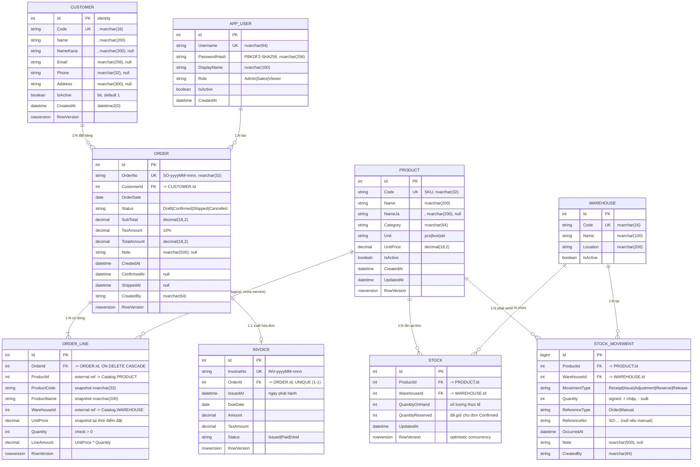
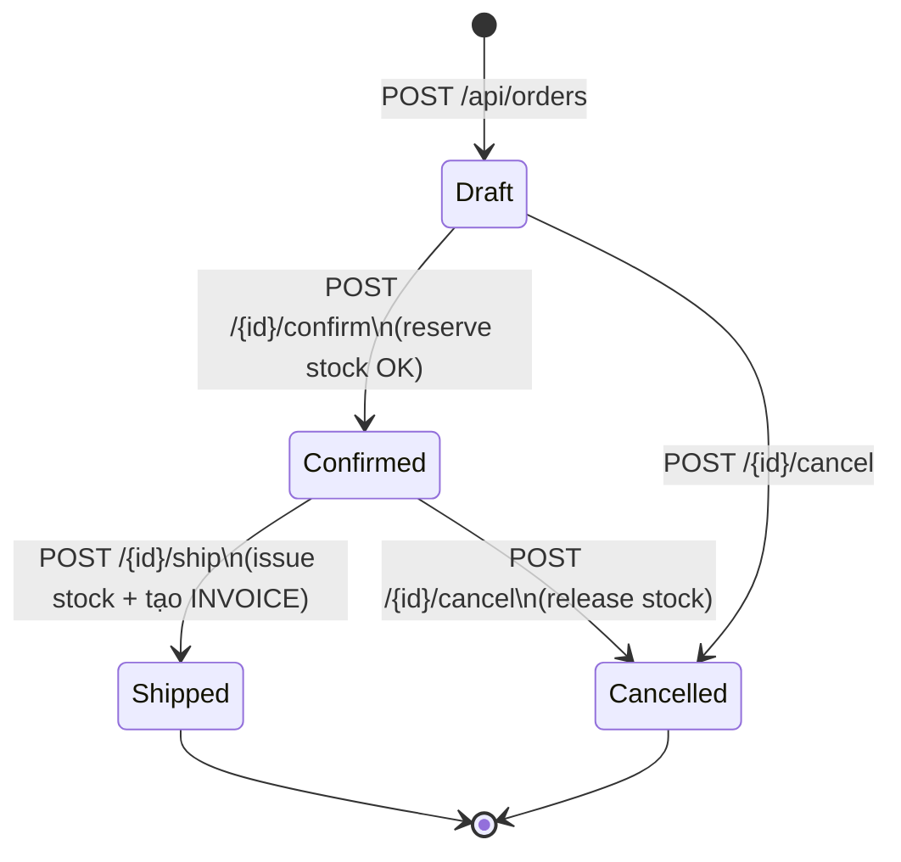

# ERD — Hệ thống Quản lý Đơn hàng & Tồn kho

> Phạm vi: 2 bounded context **Catalog** (danh mục + tồn kho) và **Ordering** (khách hàng + đơn hàng + hóa đơn), mỗi context sở hữu DB riêng. **Không có FK vật lý xuyên service** — các cột `ProductId`, `WarehouseId` trong `ORDER_LINE` là *external reference* (giữ nguyên giá trị, validate qua API).

---

## 1. Sơ đồ ERD tổng thể



### Quan hệ & cardinality

| Quan hệ | Cardinality | Ghi chú nghiệp vụ |
|---|---|---|
| CUSTOMER → ORDER | 1 : N | Xóa customer = soft delete (`IsActive = 0`), không xóa đơn |
| ORDER → ORDER_LINE | 1 : N (≥ 1) | Đơn `Draft` phải có ít nhất 1 dòng mới `Confirm` được |
| ORDER → INVOICE | 1 : 0..1 | Hóa đơn sinh tự động khi `Ship`; mỗi đơn tối đa 1 hóa đơn |
| APP_USER → ORDER | 1 : N | Lưu `CreatedBy` dạng username, không FK cứng để giữ audit khi đổi user |
| PRODUCT → ORDER_LINE | 1 : N (logical) | Cross-service; `UnitPrice`/`ProductName` **snapshot** để đơn cũ không đổi khi master đổi giá |
| PRODUCT → STOCK | 1 : N | Mỗi cặp (Product, Warehouse) đúng 1 dòng tồn |
| WAREHOUSE → STOCK | 1 : N | |
| PRODUCT / WAREHOUSE → STOCK_MOVEMENT | 1 : N | Sổ cái kho — append only, không update/delete |

---

## 2. Data dictionary (tóm tắt kiểu dữ liệu & ràng buộc)

### 2.1 CatalogDb (SQL Server)

**PRODUCT**

| Cột | Kiểu | Null | Ràng buộc |
|---|---|---|---|
| Id | int identity | no | PK |
| Code | nvarchar(32) | no | UQ `UQ_Product_Code` |
| Name | nvarchar(200) | no | |
| NameJa | nvarchar(200) | yes | dùng cho phiếu in / UI tiếng Nhật |
| Category | nvarchar(64) | no | |
| Unit | nvarchar(16) | no | default `pcs` |
| UnitPrice | decimal(18,2) | no | `CK_Product_UnitPrice >= 0` |
| IsActive | bit | no | default 1 |
| CreatedAt / UpdatedAt | datetime2(0) | no | UTC |
| RowVersion | rowversion | no | concurrency token |

**WAREHOUSE**: `Code nvarchar(16) UQ`, `Name nvarchar(100)`, `Location nvarchar(200)`, `IsActive bit`.

**STOCK**

| Cột | Kiểu | Ràng buộc |
|---|---|---|
| Id | int identity | PK |
| ProductId | int | FK → PRODUCT, `ON DELETE NO ACTION` |
| WarehouseId | int | FK → WAREHOUSE |
| QuantityOnHand | int | `CK >= 0` |
| QuantityReserved | int | `CK >= 0 AND QuantityReserved <= QuantityOnHand` |
| RowVersion | rowversion | chống lost-update khi 2 đơn cùng confirm |
| — | | `UQ_Stock_Product_Warehouse (ProductId, WarehouseId)` |

> **Available = QuantityOnHand − QuantityReserved** — không lưu cột dư để tránh lệch dữ liệu.

**STOCK_MOVEMENT**: `Id bigint identity`, index `IX_Movement_Product_OccurredAt (ProductId, OccurredAt DESC)`, `IX_Movement_ReferenceNo (ReferenceNo)` để tra cứu đối soát theo đơn.

### 2.2 OrderingDb (SQL Server)

**ORDER** indexes: `UQ_Order_OrderNo`, `IX_Order_CustomerId_CreatedAt`, `IX_Order_Status_OrderDate`.

**ORDER_LINE** indexes: `IX_OrderLine_OrderId` (covering `ProductId, Quantity`), `IX_OrderLine_ProductId` (thống kê bán chạy).

**INVOICE**: `UQ_Invoice_InvoiceNo`, `UQ_Invoice_OrderId` (đảm bảo 1-1 ở mức DB).

**APP_USER**: `UQ_AppUser_Username`.

### 2.3 Enum (lưu dạng VARCHAR, map bằng EF `HasConversion<string>()`)

| Enum | Giá trị | Ý nghĩa nghiệp vụ |
|---|---|---|
| `OrderStatus` | `Draft` | — sửa/xóa tự do, chưa giữ tồn |
| | `Confirmed` | — đã giữ tồn (reserved), in được phiếu |
| | `Shipped` | — đã trừ tồn thực tế, sinh hóa đơn |
| | `Cancelled` | — nhả tồn đã giữ |
| `MovementType` | `Receipt` / `Issue` / `Adjustment` / `Reserve` / `Release` | Sổ cái kho |
| `InvoiceStatus` | `Issued` / `Paid` / `Void` | |
| `UserRole` | `Admin` / `Sales` / `Viewer` | Phân quyền JWT claim |

---

## 3. State machine của ORDER (ràng buộc nghiệp vụ quan trọng nhất)



Bất biến (enforced trong domain, có unit test):

1. Không thể `Confirm` đơn không có dòng nào (`OrderMustHaveLines`).
2. Không thể sửa dòng hàng khi status ≠ `Draft` (`OrderNotEditable`).
3. Không thể `Cancel` đơn đã `Shipped` (`CannotCancelShippedOrder`).
4. Không thể `Ship` đơn chưa `Confirmed`.
5. `TotalAmount = SubTotal + TaxAmount`, `TaxAmount = round(SubTotal × 10%)`, `SubTotal = Σ LineAmount`, `LineAmount = UnitPrice × Quantity`.
6. Reserve không đủ tồn → trả `409` kèm danh sách thiếu, đơn **giữ nguyên** `Draft` (không half-commit).

---

## 4. Ranh giới service (bounded context)

| Entity | Service sở hữu | DB | Ai được ghi |
|---|---|---|---|
| CUSTOMER, ORDER, ORDER_LINE, INVOICE, APP_USER | **Ordering** | OrderingDb | Ordering API |
| PRODUCT, WAREHOUSE, STOCK, STOCK_MOVEMENT | **Catalog** | CatalogDb | Catalog API |
| STOCK_MONTHLY_REPORT (legacy) | **Oracle legacy** | Oracle XE | Batch job / PL/SQL (read-only cho app) |

Tham chiếu chéo chỉ qua API nội bộ:

```
POST /internal/products/lookup  { ids } -> [{ id, code, name, unitPrice }]
POST /internal/stocks/reserve  { referenceNo, items[] } -> 200 | 409 + shortages[]
POST /internal/stocks/issue   { referenceNo, items[] }
POST /internal/stocks/release  { referenceNo, items[] }
```

Bảo vệ bằng header `X-Internal-Key` (config `Internal:ApiKey`), không expose qua Ingress.

---

## 5. Legacy Oracle — mapping báo cáo tháng

Hệ thống cũ của khách hàng Nhật vẫn chạy Oracle; báo cáo tồn kho tháng được build bằng PL/SQL rồi **Crystal Report** đọc view.

| Oracle object | Vai trò | Nguồn dữ liệu |
|---|---|---|
| `STOCK_MONTHLY_REPORT` | Bảng snapshot tồn kho cuối tháng (partition theo `PERIOD_YM`) | Đổ bởi procedure |
| `V_STOCK_MONTHLY` | View join `PRODUCT` + `WAREHOUSE` cho Crystal Report | |
| `SP_BUILD_MONTHLY_STOCK_REPORT(p_period_ym)` | Procedure tổng hợp nhập/xuất/tồn đầu/tồn cuối | `STOCK_MOVEMENT` |

Chi tiết script: [`database/oracle/plsql/sp_build_monthly_stock_report.sql`](../database/oracle/plsql/sp_build_monthly_stock_report.sql).

---

## 6. Ghi chú thiết kế (trade-off — dùng để trả lời phỏng vấn)

1. **Snapshot giá & tên hàng trong `ORDER_LINE`**: master data đổi giá không được làm sai lịch sử đơn/hóa đơn. Đây là lỗi rất hay gặp ở hệ thống Nhật cũ dùng FK trực tiếp.
2. **`QuantityReserved` tách khỏi `QuantityOnHand`**: tránh việc `Confirm` làm sai lệch số liệu kiểm kê thực tế; `Shipped` mới trừ `OnHand`.
3. **Optimistic concurrency (`rowversion`)** thay vì lock bi quan: 2 sale confirm cùng SKU cuối cùng → 1 thắng, 1 nhận `409` và retry.
4. **Không FK xuyên service**: chấp nhận mất toàn vẹn tham chiếu cứng để đổi lấy khả năng deploy độc lập; bù lại bằng validate lúc tạo đơn + snapshot dữ liệu.
5. **`STOCK_MOVEMENT` append-only**: mọi thay đổi tồn đều có vết, đối soát được với báo cáo Oracle.
6. **Chia 2 service (không phải 5–7)**: quy mô ~10 bảng, tách theo *bounded context* chứ không tách theo bảng — tránh distributed transaction không cần thiết cho một hệ thống nội bộ vài chục user.
