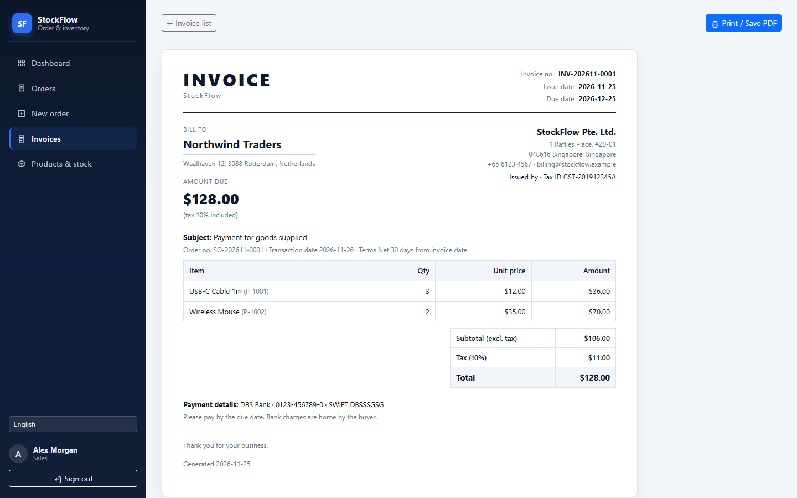
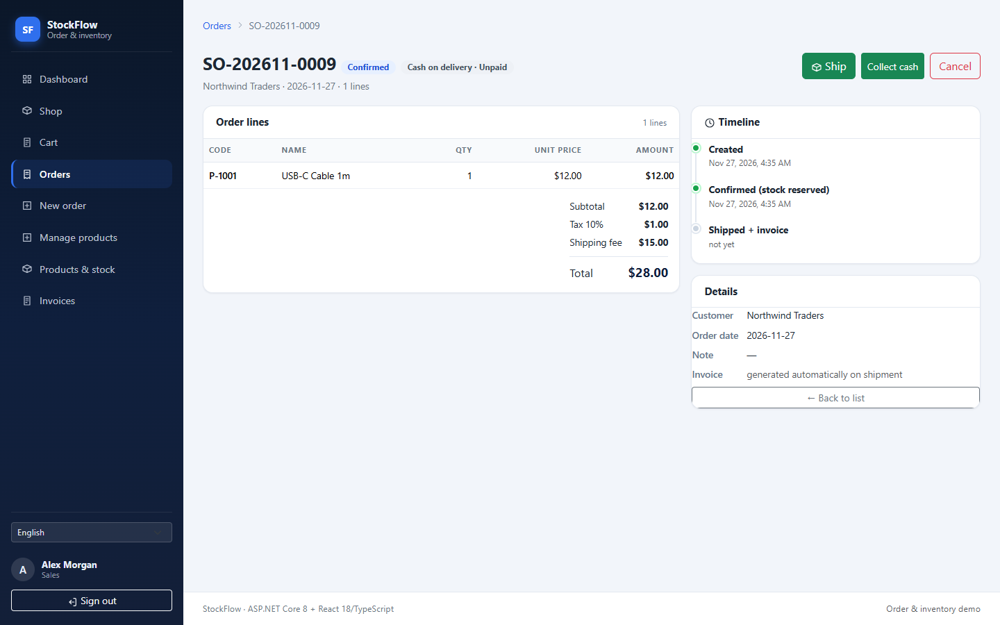

# Competitor research & improvement plan

Goal: compare this system against products that teams actually use, find the gaps that matter, and
close the most valuable ones.

Sources reviewed:

| Source | Type | What it gave us |
|---|---|---|
| [Zoho Inventory — Features](https://www.zoho.com/inventory/features/) | Commercial SaaS | The standard feature set: purchase orders, receives, transfers, picklists, pack/ship, price lists, adjustments, invoices, sales returns, reporting |
| [InvenTree](https://inventree.org/) | Open source | Stock modelled per location with "allocated to orders", sales orders with multiple shipments, BOM handling |
| [NN/G — Data Tables: Four Major User Tasks](https://www.nngroup.com/articles/data-tables/) | UX research | A table must support find / compare / view-edit one row / act; first column should be a human-readable ID; filters must show they are active |

---

## 1. Feature comparison

| Capability | Zoho Inventory | InvenTree | This system (before) | Now |
|---|---|---|---|---|
| Sales order + state machine | ✅ | ✅ | ✅ Draft → Confirmed → Shipped/Cancelled | ✅ |
| Reserve stock on confirmation | ✅ | ✅ (allocate) | ✅ reserve-first + compensation | ✅ |
| Optimistic concurrency between sellers | — | — | ✅ `rowversion` (SQL Server) | ✅ |
| Stock per warehouse | ✅ | ✅ (locations) | ✅ on hand / reserved / available | ✅ |
| Order detail page (deep link) + timeline | ✅ | ✅ | ❌ modal only | ✅ `/orders/{id}` with a timeline |
| Invoices as printable documents | ✅ | — | ❌ toast message only | ✅ `/invoices`, `/invoices/{id}`, A4/PDF |
| Invoice list | ✅ | — | ❌ | ✅ |
| Multi-language UI | ✅ | ✅ | ❌ single language | ✅ EN / VI / JA with switcher |
| Purchase orders / goods receipt | ✅ | ✅ | ❌ | — (roadmap) |
| Warehouse transfers | ✅ | ✅ | ❌ | — (roadmap) |
| Picklists / packages / partial shipment | ✅ | ✅ | ❌ (single shipment) | — (roadmap) |
| Sorting, paging, search on lists | ✅ | ✅ | ❌ (status filter only) | ⚠️ partial (roadmap P1) |
| CSV export / reports | ✅ | ✅ | ❌ | — (roadmap P1) |
| Barcode support | ✅ | ✅ | ❌ | — (not needed for the demo) |
| Audit trail | ✅ | ✅ | ⚠️ stock ledger + 3 timestamps | ⚠️ timeline with 3 milestones |

**Gaps worth closing first** (in the order a reviewer would notice them):

1. Invoices had to be real documents — not a toast.
2. Orders needed a detail page (deep-linkable, shareable, shows progress).
3. The UI had to be international: one hard-coded language does not present well outside one market.

---

## 2. What changed in this iteration

### 2.1 Printable invoices

- `GET /api/invoices/{id}` → `InvoiceDetailDto` (buyer, transaction date, lines, amounts, tax).
- `GET /api/company` → seller profile read from configuration (`Company:*`), never hard-coded.
- SPA pages `/invoices` (list) and `/invoices/{id}` (A4 document) with a **Print / Save PDF** button.
- `@media print` hides the app shell; `@page { size: A4; margin: 14mm }` produces a single clean page.
- Currency, tax rate label, bank details and payment terms all come from the seller profile, so the
  document adapts to another market without code changes.

### 2.2 Order detail page with timeline

- Route `/orders/{id}`, order numbers in lists became links.
- Timeline built from real data: `createdAt → confirmedAt → shippedAt`, plus a cancellation state.
- Business actions (confirm / ship / cancel) live on the page with role checks.

### 2.3 Multilingual UI (EN / VI / JA)

- Single message catalogue (`src/Web.Spa/src/i18n/messages.ts`), one row per key with three
  translations, so adding a language means adding a column.
- Switcher on the sign-in screen and in the sidebar; the choice persists and drives `<html lang>`.
- Currency, numbers and dates formatted with `Intl` for the active locale.
- Tests use `data-testid` selectors so they stay valid in every language.

### 2.4 Bugs found while testing (fixed)

| Bug | Fix |
|---|---|
| Quantity `0` silently became `1` (`Number(x) \|\| 1`) | keep the value, validate per line: "Line N: quantity must be greater than 0." |
| Clearing the order date submitted silently (native browser bubble) | `noValidate` + consistent in-app validation messages |
| Viewer could open `/orders/new` directly | `RequireSales` route guard |
| Sign-out / expired token did not redirect | `RequireAuth` checks the token and subscribes to auth state |

---

## 3. Roadmap (value vs cost)

| Priority | Item | Why | Cost |
|---|---|---|---|
| P1 | Server-side sort / paging / search for order lists | used daily; reviewers try it first | S |
| P1 | CSV export for orders and invoices | finance always asks for it | S |
| P2 | Goods receipt (purchase) + warehouse transfer | the two stock flows still missing vs Zoho/InvenTree | M |
| P2 | Partial shipments (multiple shipments per order) | real orders ship in parts | M |
| P3 | Second tax rate band (e.g. reduced rate) | only needed for markets that have one | M |
| P3 | Email/EDI delivery of invoice PDFs | back-office automation | L |
| P3 | Barcode / picklist | needed once there are many SKUs and a real warehouse | L |

Guardrails for the next iterations: **no new services** for P1–P2 (still two bounded contexts), and
every state change still goes through the `Order` aggregate so the existing unit tests keep passing.
